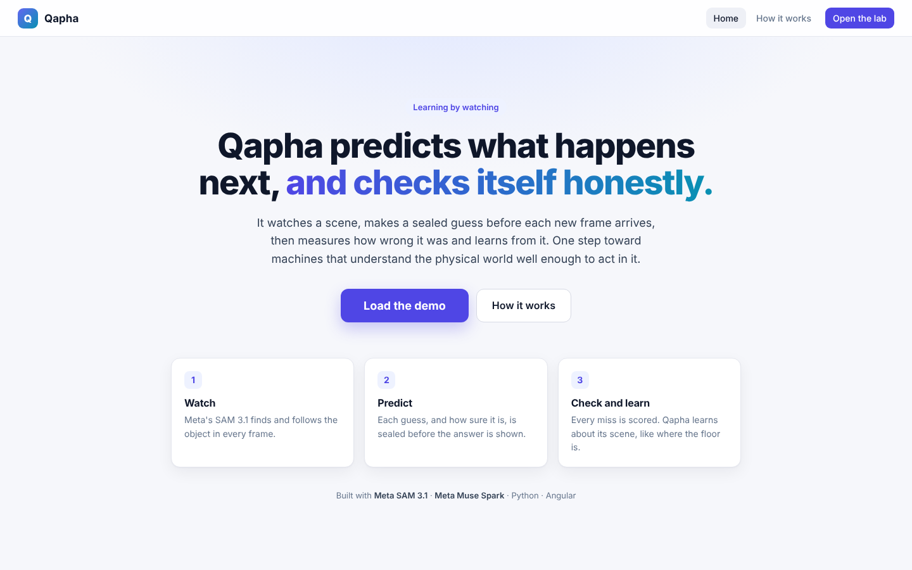
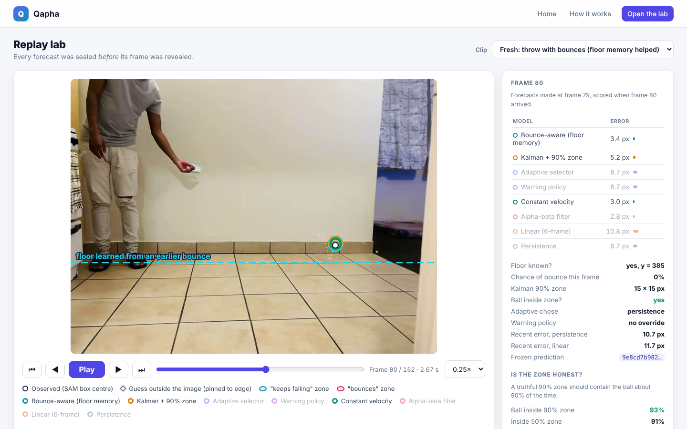
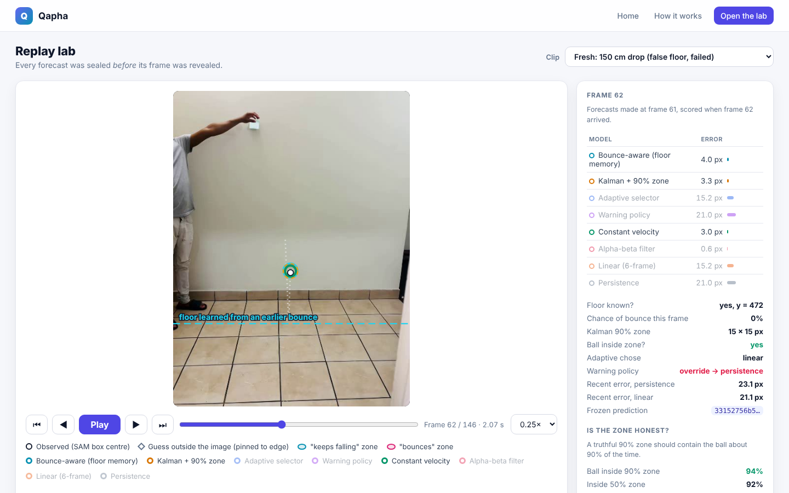
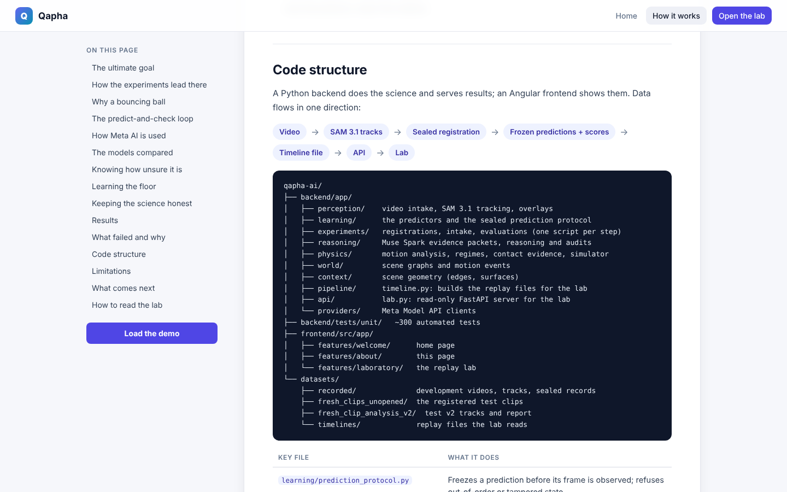

# Qapha: an AI that predicts the physical world, and checks itself honestly

**Live demo:** http://YOUR-SERVER-IP  ·  **Video:** YOUR-VIDEO-LINK
**Meta Global AI Developer Hackathon 2026** · Indie Developer Track · Theme: *Push the Frontier*

Robots, drones and machines on factory floors must predict what happens next *before* it happens.
Qapha watches a video, makes a **sealed prediction** before every new frame, scores itself when the
frame arrives, and **learns about its scene**. For example, after one bounce it remembers where the
floor is and expects the next bounce. Every result is pre-registered and reproducible, including the failures.



## How Meta AI is used

| Model | Role |
|---|---|
| **SAM 3.1** (Meta Model API) | Perception: finds and tracks the object ("blue ball") in every frame of real phone video. |
| **Muse Spark** (Meta Model API) | Reasoning over measured evidence: is a change in motion a collision? It may only cite evidence we measured; its output is validated. |

Predictions, uncertainty and scores are transparent mathematics (Kalman filters, mixtures of
hypotheses, proper scoring rules), so every number can be reproduced and tested.

## What you can see in the lab



- **White box:** where SAM 3.1 saw the ball.
- **Coloured rings:** each model's guess, sealed *before* the frame was shown.
- **Teal and pink zones:** the two competing hypotheses, *keeps falling* and *bounces*, with probabilities.
- **Dashed line:** the floor Qapha learned from an earlier bounce.
- **Chart:** error per frame for every model (click to jump; arrow keys step; space plays).

## Results (honest)

| Experiment | Outcome |
|---|---|
| Video E, pre-registered | Simple constant velocity (8.9 px) beat the original adaptive learner (21.4 px). |
| Floor memory, development video | Error at the later bounce fell from **33 px to 6.6 px**; the bounce was predicted at 99.5%. |
| Fresh phone clips, test v2 (sealed code) | Better on 2 of 3 bouncing clips; a false floor hurt the third. **H1 not supported**, H2 and H3 supported. |

The main weakness found, a bounce detector fooled by 1-pixel wobble, is documented as the next fix.



## Run it locally

```bash
# Backend (Python 3.10+)
cd backend
pip install -r requirements.txt
python -m unittest discover -s tests/unit        # ~300 tests
python -m uvicorn app.main:app --port 8000

# Frontend (Node 20+), in a second terminal
cd frontend
npm ci
npx ng serve --port 4200                          # open http://localhost:4200
```

## Project structure

```
backend/app/learning/      predictors, sealed prediction protocol, floor memory
backend/app/perception/    video intake and SAM 3.1 tracking
backend/app/reasoning/     Muse Spark evidence packets and audits
backend/app/experiments/   registrations, intake and evaluations
backend/app/pipeline/      builds replay timelines for the lab
backend/app/api/           read-only FastAPI server
frontend/src/app/          Angular app: home, how it works, lab
datasets/                  videos, SAM tracks, sealed registrations and reports
```

More detail, including the scientific method and code walkthrough, is on the app's **How it works** page.



## Limitations

Image-pixel coordinates (not metres), one-frame-ahead predictions, one object, recorded video, and a small
number of clips. Contact is inferred from motion, not physically verified.
